  

# ⚡ Awesome Resource Management

  
  
  
  
  
  

---

> **A definitive, SEO-curated directory of SaaS solutions, open-source repositories, verified pricing models, and market intelligence for Capacity Planning, Resource Scheduling, Workload Heatmaps, and Utilization Optimization.**

Whether you are an engineering director balancing sprint capacity, a PMO leader scheduling cross-functional programs, or an agency operations manager eliminating bench waste and burnout, this guide catalogs the top commercial and open-source tools to allocate your human and technical capital effectively.

---

## 📑 Table of Contents

- [📊 Sector Overview & Market Dynamics](#-sector-overview--market-dynamics)
- [💼 SaaS & Commercial Platforms](#-saas--commercial-platforms)
- [💻 Open-Source Projects & Frameworks](#-open-source-projects--frameworks)
- [🎯 Key Evaluation Criteria](#-key-evaluation-criteria)
- [🤝 How to Contribute](#-how-to-contribute)
- [⚠️ Disclaimer](#️-disclaimer)
- [📈 Star History](#-star-history)
- [💖 Support & Sponsorship](#-support--sponsorship)

---

## 📊 Sector Overview & Market Dynamics

The global **Resource Management Software** market is currently estimated at **$14.8 Billion** and is projected to expand to **$26.5 Billion by 2030**, exhibiting a robust Compound Annual Growth Rate (CAGR) of **11.8%**. Rapid adoption is accelerated by hybrid work complexities, multi-project delivery friction, and the integration of predictive AI for automated capacity rebalancing.

The sector is **moderately fragmented**:
- **Enterprise SPM / ERP Tier:** Large conglomerates rely on heavy strategic portfolio management suites (e.g., Workday, Planview) that integrate human capital management (HCM) and financials into multi-year capacity planning.
- **Specialized Best-of-Breed SaaS:** Mid-market enterprises, IT consultancies, and digital agencies gravitate toward agile, visual scheduling platforms (e.g., Float, Runn, monday.com, Resource Guru) that excel in real-time drag-and-drop allocations, placeholder demand forecasting, and employee burn-rate management.
- **Open-Source Landscape:** Fully featured open-source capacity planning remains scarce—generalist tools provide task-level time tracking, but dedicated resource heatmaps and skill-matching algorithms are predominantly maintained as proprietary enterprise modules.

---

## 💼 SaaS & Commercial Platforms

The table below catalogs premier commercial Resource Management platforms, sorted **descending by Company Size (Valuation / Annual Revenue)**.

| 🏢 Platform | 📈 Company Size *(Valuation / ARR)* | 💰 Starting Pricing | 🎁 Free Tier & Trial Limits | 🚀 Core Capabilities & Highlights |
| :--- | :--- | :--- | :--- | :--- |
| [**Workday Resource Management**](https://www.workday.com/) | **~$72 Billion Market Cap** (Public: `WDAY` • ~$8.4B ARR) | Starts at **$99 / user / month** *(Enterprise contracts typically $100K+/yr)* | **No free-forever plan**. *Trial:* Bespoke sales-guided POC sandbox and test environment on request (0-day self-serve). | Comprehensive human capital management & PSA suite; separates staffing requests from demand; unnamed placeholder roles; enterprise cost & revenue forecasting. |
| [**monday.com Work Management**](https://monday.com/) | **~$13 Billion Market Cap** (Public: `MNDY` • ~$840M+ ARR) | Starts at **$9 / seat / month** *(Basic tier, billed annually; Standard $12, Pro $19)* | **Free-forever plan:** Up to **2 seats**, 3 boards, 200+ templates, 500MB storage. *Trial:* 14-day free Pro trial (unlimited seats, no credit card required). | Visual workload dashboards; AI Sidekick smart allocation matching placeholders to people by skill and availability; effort allocation in hours or FTE. |
| [**Planview**](https://www.planview.com/) | **~$1.6 Billion Valuation** (TPG / TA Associates • ~$450M+ ARR) | Starts at **$19 / user / month** *(AgilePlace tier; ProjectPlace $20; AdaptiveWork ~$30+)* | **No free-forever plan**. *Trial:* **30-day full-featured free trial** on ProjectPlace & AgilePlace (no credit card required); guided POC for Portfolios. | Strategic Portfolio Management with Anvi AI; continuous demand vs. capacity analysis; real-time overallocation alerts; scenario trade-off simulations. |
| [**Kantata**](https://www.kantata.com/) | **~$800 Million Valuation** (Accel-KKR • Mavenlink + Kimble • ~$150M+ ARR) | Starts at **$45 / user / month** *(Kantata OX starter tier, billed annually)* | **No free-forever plan**. *Trial:* Bespoke **14-day guided sandbox demo/pilot** with customized project and client service workflows. | Purpose-built Professional Services Automation (PSA); Resource Center cross-project views; PM-to-RM approval workflows; bench availability tracking. |
| [**Float**](https://www.float.com/) | **~$150 Million Valuation** (Bootstrapped / Profitable • ~$20M+ ARR) | Starts at **$6 / person / month** *(Starter tier, billed annually; Pro $10/person/mo)* | **No free-forever plan**. *Trial:* **30-day free trial** of Pro tier with unlimited teammates & projects (no credit card required); unlimited free view-only guest accounts. | Dedicated capacity planning with live schedule calendar; actuals vs. estimate tracking; drag-and-drop allocations; overtime and time-off tracking. |
| [**Forecast**](https://www.forecast.app/) | **~$90 Million Valuation** (Balderton Capital • ~$18M ARR) | Starts at **$29 / seat / month** *(Lite tier, billed annually; Pro $49/seat/mo; 20-seat min)* | **No free-forever plan**. *Trial:* **14-day full platform free trial** with preloaded sample dataset and AI planning assistants (no credit card required). | AI-driven People Schedule heatmaps; hard vs. soft project allocations; probability-weighted pipeline demand; real-time project financial tracking. |
| [**Runn**](https://www.runn.io/) | **~$35 Million Valuation** (Venture-backed • ~$6M ARR) | Starts at **$7 / resource seat / month** *(Lite plan monthly; $5.60/seat/mo annual; Standard $11; 20-seat min)* | **No free-forever plan**. *Trial:* **30-day full-access free trial** of Standard tier with project phasing & charts (no credit card required); unlimited free non-scheduled viewer seats. | Resourcing request approval workflows; scenario modeling to test tentative pipeline projects; placeholder FTE demand charts; capacity dynamic phasing. |
| [**Saviom**](https://www.saviom.com/) | **~$20 Million Annual Revenue** (Privately held enterprise software) | Starts at **$15 / user / month** *(Blended licensing across Power, Lite, and Non-User seats)* | **No free-forever plan**. *Trial:* **60-day custom enterprise free trial** with organizational data onboarding and dedicated implementation support. | Enterprise-scale workforce capacity planning; multi-dimensional skills inventory; predictive bench management; vacancy and requisition forecasting. |
| [**Mosaic**](https://www.mosaicapp.com/) | **~$15 Million ARR** ($20M+ VC Funding • Founders Fund) | Starts at **$9.99 / user / month** *(Team plan, billed annually; Business $14.99/user/mo)* | **No free-forever plan**. *Trial:* **30-day full access free trial** with AI resource planner and workload heatmaps (no credit card required). | AI project finder and team builder (Chello); automated workload forecasting; hiring demand analysis; visual workload heatmaps by hours or percentage. |
| [**Resource Guru**](https://resourceguruapp.com/) | **~$6 Million Annual Revenue** (Independent UK SaaS) | Starts at **$4.16 / person / month** *(Grasshopper tier, billed annually; Blackbelt $6.65, Master $10)* | **No free-forever plan**. *Trial:* **30-day free trial** of Master tier with clash prevention, unlimited users and projects (no credit card required). | Lightweight visual team scheduling calendar; smart clash management; meeting room & equipment resource booking; vacation and holiday allowance tracking. |

---

## 💻 Open-Source Projects & Frameworks

Open-source tooling in resource management is often embedded inside broader ERP, Project Management, or Time Tracking software. The list below is sorted **descending by GitHub Star Count** with active social star badges linked directly to each project's stargazers page.

1. [**Plane**](https://github.com/makeplane/plane)   
   Modern open-source software development and project management platform. Features work cycles, backlog modules, and team member workload indicators. Provides task-level assignment and status monitoring; custom capacity heatmaps require community extensions.

2. [**Odoo**](https://github.com/odoo/odoo)   
   Extensible open-source enterprise suite featuring dedicated Planning, Project, and Timesheet apps. Allows scheduling team shifts, forecasting project resource needs, and tracking actual vs. planned hours across departments.

3. [**ERPNext**](https://github.com/frappe/erpnext)   
   Full-featured open-source ERP built on the Frappe framework. Includes comprehensive Human Resources and Project Management modules with resource allocation, employee work records, attendance tracking, and project cost centers.

4. [**OpenProject**](https://github.com/opf/openproject)   
   Web-based project management system with Gantt charts, work breakdowns, and time logging.  
   > ⚠️ **Important Caveat**: OpenProject 17.7+ introduced a dedicated **Resource Management Module** (department hierarchies, availability heatmaps, user working-time models), but this module is **Enterprise-only** (paid license). The free Community Edition provides project scheduling and time tracking without advanced capacity heatmaps.

5. [**Planka**](https://github.com/plankanban/planka)   
   Lightweight, real-time open-source Kanban board platform. Provides intuitive task assignments, user avatar indicators, card timers, and milestones for small teams tracking resource distribution across deliverables.

6. [**Leantime**](https://github.com/Leantime/leantime)   
   Strategic project management system tailored for non-project managers and cross-functional teams. Combines goal-oriented delivery, time tracking, task milestones, and individual workload awareness.

7. [**Gauzy**](https://github.com/ever-co/ever-gauzy)   
   Open-source ERP and HR management software tailored for small businesses and remote teams. Features timesheets, staff planning, project cost tracking, and employee availability calendars.

8. [**Kimai**](https://github.com/kimai/kimai)   
   Production-ready open-source time tracker and billing application. Captures hours worked per team member against activities, customers, and projects with comprehensive reporting and budget control.

---

## 🎯 Key Evaluation Criteria

When selecting a resource management solution, evaluate platforms across these four critical operational dimensions:

- 👥 **Capacity vs. Demand Modeling:** Does the tool distinguish between unnamed placeholder roles (future demand) and confirmed employee assignments?
- 📊 **Workload Heatmaps & Overtime Protection:** Can resource managers spot over-allocated and under-allocated engineers in real time across sprints and client engagements?
- 🧩 **Skills Matrix & Rebalancing:** Does the system capture team capabilities, certifications, and seniority to intelligently suggest the best candidates for open roles?
- 💰 **Billing & Realized Utilization:** Can actual timesheet entries be reconciled against estimated allocations to calculate profit margins, billable percentages, and bench costs?

---

## 🤝 How to Contribute

Contributions from resource managers, engineering leaders, and open-source contributors are welcome!

1. 🍴 Fork the repository.
2. 📝 Add or update entries in `README.md` maintaining the existing tabular or social badge format.
3. 🔍 Verify that pricing, free tier terms, and URLs are backed by official documentation.
4. 🚀 Submit a Pull Request with a descriptive summary of your changes.

Check out [Awesome-Awesome-Awesome](https://github.com/ishandutta2007/Awesome-Awesome-Awesome) for more curated lists!

---

## ⚠️ Disclaimer

- This repository is a community-curated educational index. Products, logos, and trademarks belong to their respective owners.
- Pricing plans, tier limits, and trial terms are subject to change by vendors; always verify directly on official provider websites.
- Ensure that employee workload monitoring and capacity analytics comply with applicable local labor regulations and workplace privacy standards.

---

## 📈 Star History

---

## 💖 Support & Sponsorship

Thank you for visiting **Awesome Resource Management**! If this curated guide helps you streamline your team's capacity, optimize project allocations, or make informed tooling decisions:

- ⭐ **Star** this repository to show your appreciation!
- 🍴 **Fork** it to build your internal team checklist or taxonomy.
- 📢 **Share** it with your fellow engineering managers, PMO directors, and operations leads.
- ☕ **Buy me a coffee / Become a sponsor:** Your backing fuels continuous updates, deep pricing research, and open-source curation!

👉 **[Support on GitHub Sponsors Dashboard](https://github.com/sponsors/ishandutta2007)**

---

  <b>Curated with care for resource managers, PMO teams, and engineering leaders worldwide.</b>

